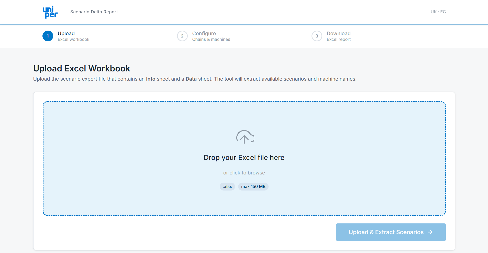
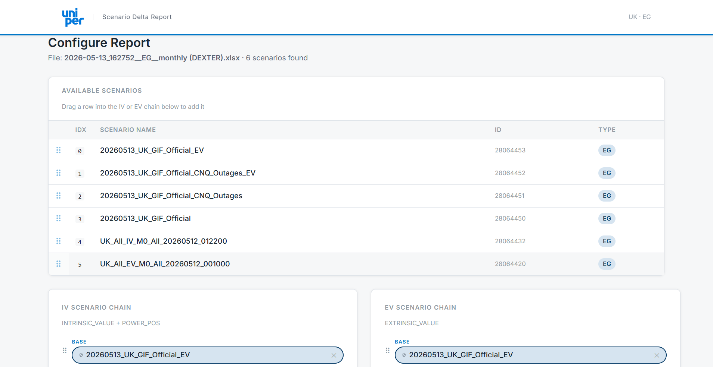
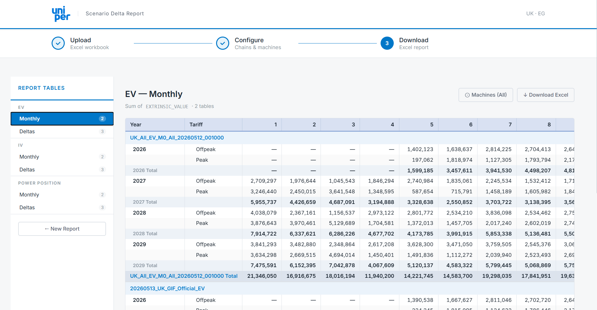

# Scenario Delta Report Generator

**Author:** Antonio Militello

## Overview
The **Scenario Delta Report Generator** is a reporting tool designed to parse, compare, and summarize scenario-based generation outputs from Excel workbooks. It handles complex nomination/scenario processes where scenarios form a logical chain (e.g., Base -> Intermediate -> Final).

## Windows Executable (End Users)

The application ships as a single file, `ScenarioDeltaReport.exe`. Users do not need Python, Node.js or any other installation.

1. Double-click `ScenarioDeltaReport.exe`.
2. A console window opens with the credits and the local address (for example `http://127.0.0.1:53124`). The default browser opens the application automatically.
3. Close the console window to stop the application.

Uploaded workbooks are stored temporarily in `%LOCALAPPDATA%\ScenarioDeltaReport` and stale uploads are removed automatically.

### Building The Executable

Complete the setup below (Miniconda + Node.js). Then run this from the repository root:

```powershell
conda activate nomination-process
.\packaging\build.ps1
```

The script builds the React frontend (`frontend/dist`), installs PyInstaller and bundles everything into `dist\ScenarioDeltaReport.exe` using [packaging/ScenarioDeltaReport.spec](packaging/ScenarioDeltaReport.spec).

## Windows Setup And Run Guide

Complete these steps once on a Windows work laptop. Commands below use PowerShell. Close and reopen PowerShell (and the VS Code terminal) after changing `Path`, because existing terminals do not receive the new environment variables.

### 1. Install Git

1. Download Git for Windows from the official page: [git-scm.com/download/win](https://git-scm.com/download/win).
2. Run the downloaded installer. The default selections are suitable; ensure **Git from the command line and also from 3rd-party software** is selected when that option is shown.
3. Open a new PowerShell window and verify the installation:

	```powershell
	git --version
	```

	The command should print a Git version, for example `git version 2.x.x`.

### 1.1 Install Visual Studio Code

1. Download Visual Studio Code from the official page: [code.visualstudio.com/Download](https://code.visualstudio.com/Download).
2. Choose the **Windows User Installer** unless your IT team directs you to use the system installer.
3. Run the downloaded file and follow the prompts. Open the cloned project folder in VS Code when it completes.

### 2. Install Python With Miniconda

Python package installers are blocked on some managed laptops. Miniconda installs Python and isolated environments without needing administrator access. It should be installed only in the current user's folder, not in `Program Files`.

> **Important:** The official Windows Miniconda download is a self-extracting `.exe`; Anaconda does not provide a supported ZIP archive to unzip manually. Downloading the file with PowerShell does not bypass an application-execution policy. If your company blocks running it, ask IT to approve the official file or run the deployment command below. Do not use unverified archives.

1. Open **PowerShell** and download the official 64-bit Windows Miniconda file:

	```powershell
	$minicondaInstaller = Join-Path $env:USERPROFILE 'Downloads\Miniconda3-latest-Windows-x86_64.exe'
	Invoke-WebRequest -Uri 'https://repo.anaconda.com/miniconda/Miniconda3-latest-Windows-x86_64.exe' -OutFile $minicondaInstaller
	```

2. If executable installation is allowed, install silently into your user directory. This is the equivalent of extracting the distribution to `C:\Users\<your-user-name>\miniconda3`; it does not require an administrator installation.

	```powershell
	Start-Process -FilePath $minicondaInstaller -ArgumentList '/InstallationType=JustMe', '/RegisterPython=0', '/AddToPath=0', '/S', "/D=$env:USERPROFILE\miniconda3" -Wait
	```

	If the command is blocked, give the downloaded file and this exact target directory to IT. A ZIP-only procedure is not available for the official Miniconda Windows distribution.

3. Add Miniconda to your **user** `Path` manually. Do not create `PYTHONHOME` or `PYTHONPATH` variables.

	1. Press the Windows key, search for **environment variables**, and select **Edit the system environment variables**.
	2. In **System Properties**, select **Environment Variables...**.
	3. In the upper **User variables for <your-user-name>** section, select `Path`, then select **Edit**. If `Path` does not exist, select **New** and name it `Path`.
	4. Select **New** for each of these entries, replacing `<your-user-name>` with your Windows user name:

		```text
		C:\Users\<your-user-name>\miniconda3
		C:\Users\<your-user-name>\miniconda3\Scripts
		C:\Users\<your-user-name>\miniconda3\Library\bin
		```

	5. Select **OK** in every open dialog, then close all PowerShell and VS Code terminal windows.

4. Open a new PowerShell window and test the installation:

	```powershell
	where.exe conda
	conda --version
	conda create --name nomination-process python=3.12 --yes
	conda activate nomination-process
	python --version
	```

	`where.exe conda` should point to your user `miniconda3` directory and `python --version` should print Python 3.12. If `conda activate` is not recognized, run `conda init powershell`, close PowerShell, and open it again.

5. From the repository root, activate the environment and install the backend dependencies:

	```powershell
	conda activate nomination-process
	python -m pip install --upgrade pip
	python -m pip install -r requirements.txt
	```

6. If you get an error message like this:

	```text
	CondaSSLError: Encountered an SSL error.
	Most likely a certificate verification issue.

	SSLError: [SSL: CERTIFICATE_VERIFY_FAILED]
	certificate verify failed: unable to get local issuer certificate
	```

	Then you need to run the following command:

	```powershell
	conda config --set ssl_verify false
	```

### 3. Install Node.js And npm Without An MSI

`npm` is included with the Node.js ZIP binary. Download the current LTS **Windows x64 Binary (.zip)** from the official page: [nodejs.org/en/download](https://nodejs.org/en/download). This guide uses the ZIP because it avoids the MSI installer.

1. In PowerShell, download a current LTS ZIP, then extract it into your user directory. Replace the version in the URL and folder name if the download page lists a newer LTS release.

	```powershell
	$nodeVersion = 'v24.19.0'
	$nodeZip = Join-Path $env:USERPROFILE "Downloads\node-$nodeVersion-win-x64.zip"
	$nodeHome = Join-Path $env:USERPROFILE "tools\node-$nodeVersion-win-x64"
	Invoke-WebRequest -Uri "https://nodejs.org/dist/$nodeVersion/node-$nodeVersion-win-x64.zip" -OutFile $nodeZip
	New-Item -ItemType Directory -Path (Split-Path $nodeHome) -Force | Out-Null
	Expand-Archive -Path $nodeZip -DestinationPath (Split-Path $nodeHome) -Force
	```

	The resulting binaries are in `C:\Users\<your-user-name>\tools\node-v24.19.0-win-x64`. Keep this folder in your user directory so no administrator permission is required.

2. Add the extracted Node folder to the **user** `Path`:

	1. Press the Windows key, search for **environment variables**, and select **Edit the system environment variables**.
	2. Select **Environment Variables...**.
	3. In **User variables**, select `Path` and then **Edit**.
	4. Select **New**, enter the Node folder, for example `C:\Users\<your-user-name>\tools\node-v24.19.0-win-x64`, and select **OK** in every dialog.
	5. Close all terminal windows and open a new PowerShell window.

3. Test Node.js and npm:

	```powershell
	where.exe node
	node --version
	npm --version
	```

	The first command should point to the extracted `tools\node-...` directory. The latter two commands should print version numbers.

### 4. Install Frontend Dependencies And Run Both Services

TypeScript is already declared in the frontend's development dependencies. Do **not** install it globally; `npm install` downloads the project-pinned version and `npx tsc` runs that local version.

1. Clone the repository and enter its root folder:

	```powershell
	git clone <repository-url>
	Set-Location nomination_process
	```

2. Open two PowerShell terminals. In the first, start the FastAPI backend from the repository root:

	```powershell
	conda activate nomination-process
	uvicorn backend.main:app --reload --host 127.0.0.1 --port 8000
	```

	Verify it in a browser at [http://127.0.0.1:8000/healthz](http://127.0.0.1:8000/healthz). It should return `{"status":"ok"}`.

3. In the second terminal, start the Vite frontend:

	```powershell
	Set-Location frontend
	npm install
	npx tsc --noEmit -p tsconfig.app.json
	npm run dev
	```

4. Open [http://localhost:5173](http://localhost:5173). Keep both terminals running while using the application. The frontend forwards `/api` requests to the backend at port `8000`.

## How It Works
1. **Upload**: Users upload an Excel Export containing an Info sheet and a Data sheet.
2. **Scenario Extraction**: The system identifies the scenarios from the Info sheet.
3. **Chain Configuration**: The user defines custom scenario comparison chains in the web UI.
4. **Machine Filtering**: Users can filter down to specific MACHINE_NAMEs, triggering instant front-end aggregations.
5. **Computation**: The backend processes step deltas and cumulative deltas across all months.
6. **Report Generation**: The frontend downloads a heavily formatted Excel representation mirroring Pivot Table aesthetics.

## Screenshots

### 1. Upload & Scenario Extraction


### 2. Scenario Chain Configuration


### 3. Machine Filter & Interactive Pivot


---
*Scenario Delta Report Generator — developed by Antonio Militello.*

*For detailed technical information, architecture, file structures, and implementation details, please see [project.md](project.md).*
